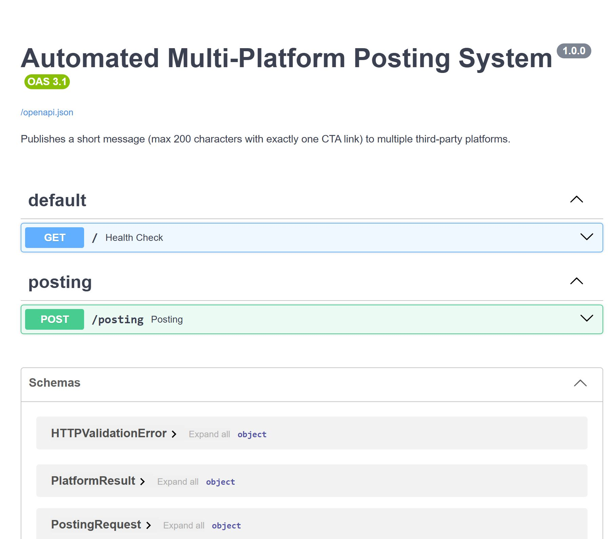
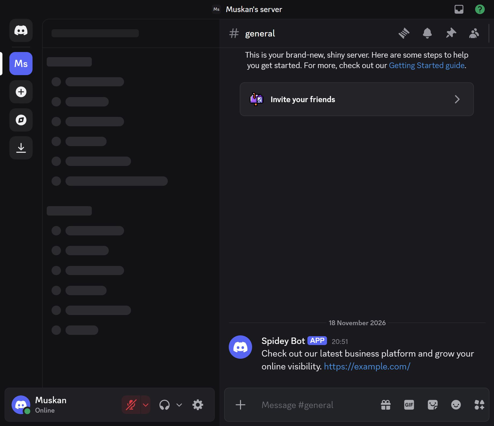
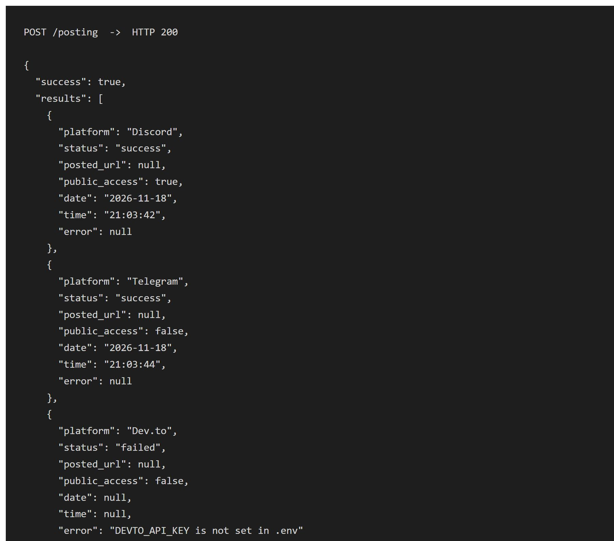

# Automated Multi-Platform Posting System

A Python / FastAPI application that publishes a short message to **multiple
third-party platforms at once** through their official APIs.

Send one message to a single endpoint and get back a report showing, for every
platform, whether the post succeeded, the public URL, the date/time and any
error details.

---

## How it works (in simple words)

Imagine you write one letter and want it delivered to 6 different offices.
Instead of posting it yourself 6 times, you hand it to a receptionist who:

1. **Checks the letter** — is it under 200 characters? does it have exactly
   one link? is the link valid? (`app/schemas.py` does this with Pydantic)
2. **Gives a copy to 6 delivery boys** — one for each platform
   (`app/platforms/`)
3. **Collects the receipts** — even if delivery boy #2 fails, boys #3–#6
   still go out (`app/services/posting_service.py` has a try/except around
   each one)
4. **Hands you a report** — one row per platform saying success/failed, the
   posted URL, date, time and error message

The whole thing lives behind one URL: `POST http://localhost:4000/posting`

---

## Table of Contents

- [Features](#features)
- [Tech Stack](#tech-stack)
- [Project Structure](#project-structure)
- [Setup and Execution](#setup-and-execution)
- [API Reference](#api-reference)
- [Supported Platforms](#supported-platforms)
- [Input Validation Rules](#input-validation-rules)
- [Error Handling Design](#error-handling-design)
- [Running the Tests](#running-the-tests)
- [Screenshots](#screenshots)
- [Security Notes](#security-notes)

---

## Features

- ✅ Single REST endpoint: `POST /posting`
- ✅ Message validation: max **200 characters**, **exactly one** CTA link, URL
  validation (all handled automatically by Pydantic → HTTP 422 on bad input)
- ✅ **6 platform integrations**: Discord, Telegram, Dev.to, Mastodon,
  Hashnode, Pastebin
- ✅ Platforms run **independently** — one failure never stops the others
- ✅ Per-platform report: platform, status, posted URL, public access, date,
  time, error
- ✅ Credentials stored in `.env` (never committed to GitHub)
- ✅ Interactive API documentation at `/docs` (Swagger UI)
- ✅ Automated test suite (9 tests)

## Tech Stack

| Technology | Purpose |
|---|---|
| Python 3.12 | Programming language |
| FastAPI | Web framework for the REST API |
| Uvicorn | ASGI server that runs the app |
| Pydantic | Automatic request validation |
| HTTPX | Calling third-party platform APIs |
| python-dotenv | Loading secrets from `.env` |
| pytest | Automated tests |

---

## Project Structure

```text
automated-posting/
│
├── app/
│   ├── main.py                  # FastAPI app + the /posting endpoint
│   ├── schemas.py               # Pydantic request/response models + validation
│   ├── config.py                # Reads credentials from .env
│   ├── utils.py                 # Shared helpers (URL detection, title builder)
│   ├── platforms/
│   │   ├── base.py              # BasePlatform (common interface)
│   │   ├── discord_webhook.py   # Discord integration
│   │   ├── telegram_bot.py      # Telegram integration
│   │   ├── devto.py             # Dev.to integration
│   │   ├── mastodon.py          # Mastodon integration
│   │   ├── hashnode.py          # Hashnode integration (GraphQL)
│   │   └── pastebin.py          # Pastebin integration
│   └── services/
│       └── posting_service.py   # Loops over platforms, isolates failures
│
├── tests/
│   └── test_posting.py          # 9 automated tests
│
├── .env.example                 # Template with placeholder credentials
├── .gitignore                   # Keeps .env out of Git
├── requirements.txt
├── pytest.ini
└── README.md
```

---

## Setup and Execution

### 1. Install Python

Python 3.10+ is required (developed and tested on Python 3.12).

### 2. Install the dependencies

```bash
pip install -r requirements.txt
```

### 3. Configure your credentials

Copy the template and fill in your own API keys:

```bash
cp .env.example .env
```

Then edit `.env` and add your keys (see [Supported
Platforms](#supported-platforms) for step-by-step instructions on where to get
each key).

> The app also runs **without** any keys — every platform will simply report
> `status: "failed"` with a clear message such as
> `"DEVTO_API_KEY is not set in .env"`. This is useful to test the API itself.

### 4. Start the server

```bash
uvicorn app.main:app --host 0.0.0.0 --port 4000
```

### 5. Open the API documentation

Visit **http://localhost:4000/docs** — FastAPI generates an interactive
Swagger UI where you can try the endpoint directly from the browser.

---

## API Reference

### `POST /posting`

**Request body**

```json
{
  "message": "Check out our latest business platform and grow your online visibility. https://example.com"
}
```

**Success response** (`200 OK`)

```json
{
  "success": true,
  "results": [
    {
      "platform": "Discord",
      "status": "success",
      "posted_url": "https://discord.com/channels/123/456/789",
      "public_access": true,
      "date": "2026-11-15",
      "time": "10:30:00",
      "error": null
    },
    {
      "platform": "Dev.to",
      "status": "failed",
      "posted_url": null,
      "public_access": false,
      "date": null,
      "time": null,
      "error": "HTTP 401: {\"error\":\"unauthorized\"}"
    }
  ]
}
```

`success` is `true` when **at least one** platform accepted the message.

**Validation error response** (`422 Unprocessable Entity`)

```json
{
  "detail": [
    {
      "type": "value_error",
      "loc": ["body", "message"],
      "msg": "Value error, Message must not exceed 200 characters (got 220).",
      "input": "...",
      "ctx": {"error": {}}
    }
  ]
}
```

### Example with cURL

```bash
curl -X POST http://localhost:4000/posting \
  -H "Content-Type: application/json" \
  -d '{"message": "Check out our latest business platform and grow your online visibility. https://example.com"}'
```

---

## Supported Platforms

| Platform | API type | Credential needed | Where to get it | API docs |
|---|---|---|---|---|
| **Discord** | REST (webhook) | Webhook URL | Discord → Server Settings → Integrations → Webhooks → New Webhook | [Webhook docs](https://discord.com/developers/docs/resources/webhook) |
| **Telegram** | REST (Bot API) | Bot token + chat id | Chat with `@BotFather` → `/newbot`; chat id from `@userinfobot` | [Bot API](https://core.telegram.org/bots/api#sendmessage) |
| **Dev.to** | REST | API key | dev.to → Settings → Extensions → DEV Community API Keys | [Forem API v1](https://developers.forem.com/api/v1) |
| **Mastodon** | REST | Access token + instance URL | Instance → Preferences → Development → New Application | [Statuses API](https://docs.joinmastodon.org/methods/statuses/#create) |
| **Hashnode** | GraphQL | Personal Access Token + publication id | hashnode.com/settings/developer → Generate New Token | [Hashnode API](https://apidocs.hashnode.com/) |
| **Pastebin** | REST | Developer API key | pastebin.com/doc_api → Generate your API key | [Pastebin API](https://pastebin.com/doc_api) |

### Getting the Hashnode publication id

Run this query with your token (e.g. in the [Hashnode GQL
playground](https://gql.hashnode.com)):

```graphql
query {
  me {
    username
    publications(first: 5) {
      edges { node { id url } }
    }
  }
}
```

Put the `node.id` value into `HASHNODE_PUBLICATION_ID`.

> **Note on "LLM platforms":** the assignment mentions posting to supported LLM
> platforms as well. The platforms above were chosen because they expose
> stable, publicly documented APIs that a beginner can integrate within the
> time limit; all of them are content platforms where AI-assisted posts are
> welcome. The architecture makes adding any further platform (including an
> LLM/API service) a matter of creating one new file in `app/platforms/`.

---

## Input Validation Rules

| Rule | Error message |
|---|---|
| Message must not be empty | `Message must not be empty.` |
| Max 200 characters | `Message must not exceed 200 characters (got 220).` |
| Exactly one link | `Message must contain exactly one CTA link (found 0).` |
| Link must be a valid http(s) URL with a domain | `'https://nodot' is not a valid URL.` |

Validation lives in `app/schemas.py` (Pydantic `field_validator`), so FastAPI
automatically replies with HTTP 422 — no manual `if` statements in the
endpoint.

---

## Error Handling Design

The core requirement — *"if one platform fails, continue posting to the
remaining platforms"* — is implemented in
`app/services/posting_service.py`:

```python
for platform in get_platforms():
    try:
        results.append(platform.post(message))
    except Exception as exc:
        results.append(_unexpected_failure(platform.name, exc))
```

Three layers of protection:

1. **Missing credentials** → platform returns a friendly `failed` result
   without even making a network call.
2. **HTTP/network errors** → each platform catches `httpx.HTTPError`
   internally and converts it into a `failed` result with the error details.
3. **Unexpected crashes** → the service-level `try/except` guarantees the
   remaining platforms still run and the endpoint always returns a valid
   report instead of a 500 error.

---

## Running the Tests

```bash
pytest -v
```

The suite (9 tests) covers:

- happy path: valid message → all platforms reported
- one platform crashing → others still run, overall `success: true`
- every platform failing → `success: false`
- message > 200 characters → 422
- message with 0 links → 422
- message with 2 links → 422
- invalid URL → 422
- empty / missing message → 422
- message of exactly 200 characters → accepted

Platform calls are replaced with fake objects, so tests never post anything
for real and never require API keys.

---

## Screenshots

All screenshots below were taken during a **live run on 18 November 2026**,
with the server started locally and real credentials configured in `.env`.

### 1. Interactive API documentation (`/docs`)

FastAPI's generated Swagger UI — the endpoint can be tried directly from the
browser.



### 2. Real message posted to Discord

The same message sent through `POST /posting` arrived in the Discord
`#general` channel via the webhook, posted by the bot at **20:51**:



### 3. API response — 2 platforms succeeded

The JSON report returned by the endpoint. Discord and Telegram both report
`status: "success"` with date/time, while platforms without keys fail
gracefully with a clear error — proving one platform's failure never stops
the others:



> **Live verification (2026-11-18):** Discord ✅ and Telegram ✅ posted real
> messages. The remaining four platforms (Dev.to, Mastodon, Hashnode,
> Pastebin) are fully implemented and covered by the test suite, but report
> `"not set in .env"` because no API keys were configured for them — they are
> enabled simply by adding keys to `.env`.

---

## Security Notes

- `.env` is listed in `.gitignore` — **no real credentials are committed**
- `.env.example` contains empty placeholders only
- All keys are read at runtime through `app/config.py`

---

## Assignment

Practical test for the **Dxora Technologies / CREST** Python developer
selection process. Deadline: 22 November 2026.
